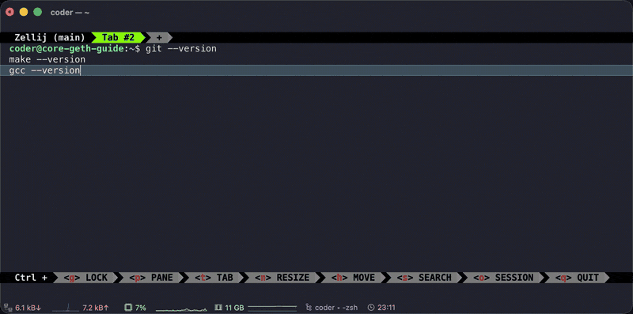
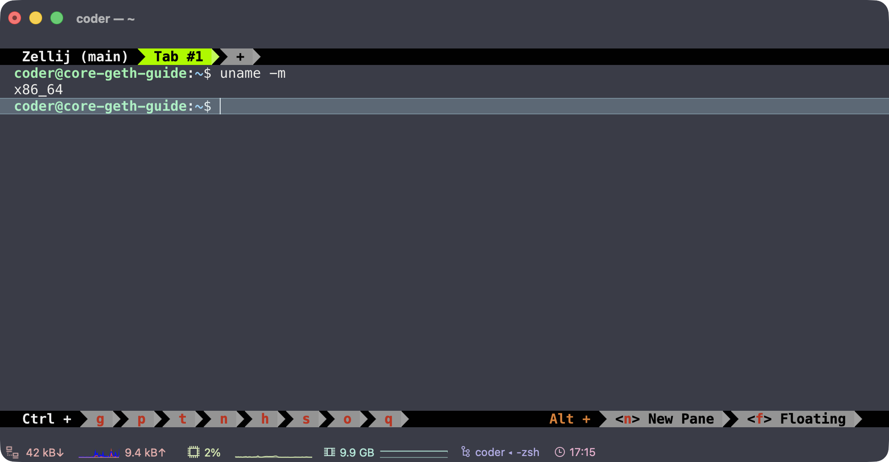
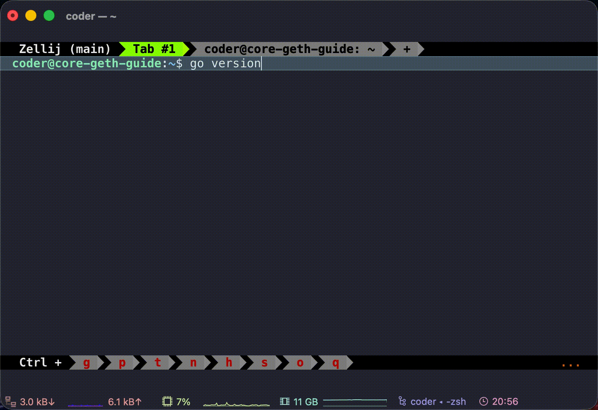
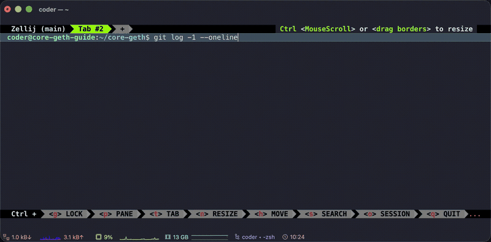
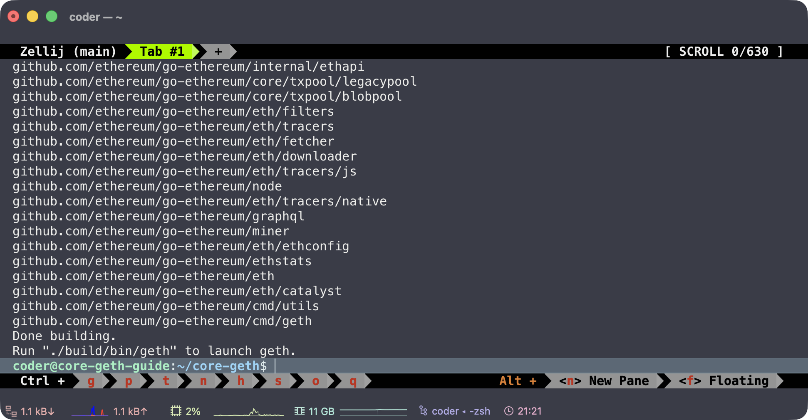
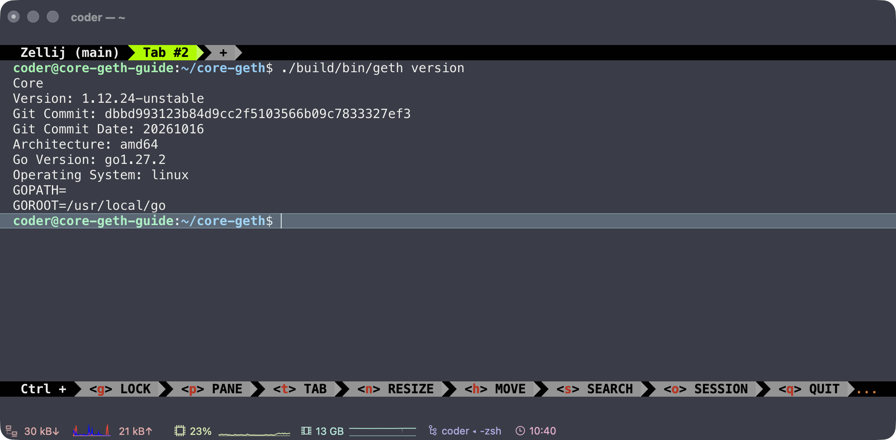
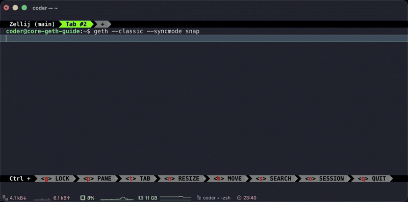
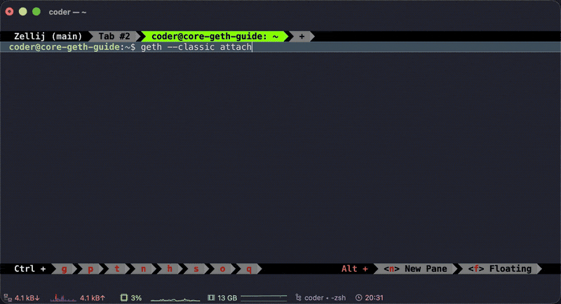
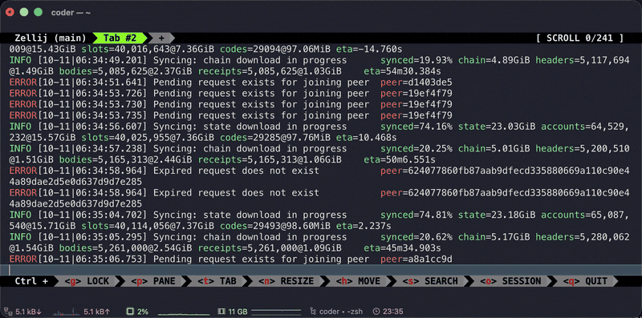

Running a node is one of the most significant ways anyone can contribute to Ethereum Classic. Every node keeps its own copy of the blockchain, a record of every block, transaction and smart contract. More nodes make ETC more decentralized and the network more resilient, plus it lets you interact with the network without relying on a trusted third party. It's also easier to set up than you might think, and this guide will show you how, step-by-step.

By the end of this guide, you'll be running your very own node: a copy of the ETC blockchain on your own hardware that you can talk to directly. You need little to no experience, and if you get stuck at any point, ask in [r/EthereumClassic](https://www.reddit.com/r/EthereumClassic/). The community is always happy to help.

core-geth is the most popular Ethereum Classic client, used by roughly 63% of the network, and setting it up is pretty straightforward.

This is part 1 of a three-part series. In this part, you'll build core-geth from its source code, start your node, and talk to it.

### Choose your path

| Path | Version | Choose it if | Follow |
| --- | --- | --- | --- |
| **A. Build the stable release** (recommended) | [v1.12.23 "Argos"](https://github.com/etclabscore/core-geth/releases/tag/v1.12.23), the latest stable release | You want a stable node and to see how it's made | Steps 1–8, option A in step 3 |
| **B. Build the pre-release** | v1.12.24, still being reviewed in [pull request #702](https://github.com/etclabscore/core-geth/pull/702) | You want to help test the next version before it's released | Steps 1–8, option B in step 3 |

For this guide, we'll use the unreleased v1.12.24 of core-geth as a preview of the next release, but you can go with option A (v1.12.23 "Argos") and follow the exact same steps. Paths A and B are identical except for one choice in step 3: the core-geth version. If you're not sure what to choose, choose A, the stable v1.12.23 Argos release.

**Not covered here:** waiting for a full sync, mining, running the node as a background service, or opening it up to the internet. See Next steps. This is just a basic guide to setting up a core-geth node.

## Before you start

You need:

- A Linux machine running Ubuntu or Debian. This guide was recorded on a cloud Linux machine over SSH, but a Raspberry Pi or computer at home works the same way.
- An account that can run `sudo` (admin) commands.
- A terminal, and about 30 minutes.

## Step 1: Install the basic tools

We're going to build core-geth from its source code, so you need a few standard tools first:

- **git** downloads the code.
- **build-essential** provides `make` and a compiler, which turn code into a program.
- **curl** and **wget** download files.

Run these from any folder:

```bash
sudo apt update
```

**What you'll see:** a list of lines starting with `Hit:` or `Get:`, ending with something like:

```text
Reading package lists... Done
```

**What it means:** your machine has fetched the latest list of software it can install.

```bash
sudo apt install -y git build-essential curl wget
```

**What you'll see:** a lot of text scroll past for a minute or two, then your prompt returns. If the tools were already installed, you'll see `is already the newest version` instead. Both are fine.

Check that each tool is installed:

```bash
git --version
make --version
gcc --version
```

**What you'll see:** a version line for each, such as:

```text
git version 2.43.0
GNU Make 4.3
gcc (Ubuntu 13.2.0-23ubuntu4) 13.2.0
```

Your numbers may differ.

**What it means:** all three tools are ready. If one says `command not found`, run the install command again.



## Step 2: Install Go 1.27.2

core-geth is written in the Go programming language, so you need Go installed to build it.

We use Go 1.27.2, the latest version tested with this guide.

<details>
<summary>Why Go 1.27.2?</summary>

It's the latest stable version of Go, and it builds both paths in this guide. This guide was tested with Go 1.27.2, so it's recommended you use the same version to get the same results. Using a current version also means you get Go's latest security fixes: Go only keeps fixing its two newest major versions. The pre-release code in path B (core-geth v1.12.24) updates core-geth's Go setup to match go-ethereum's v1.17.5 release and needs Go 1.24 or newer.

In the pull request's benchmarks, moving from Go 1.21 to Go 1.25 made core-geth's EVM (the part that runs transactions and smart contracts) about 4% faster and cut its memory allocations by about 11%.

</details>

Skip `sudo apt install golang` here: Ubuntu's version may be older than the one this guide uses, so we'll install Go from the official Go website instead.

**First, check which version to download.** Go comes in different versions for different processors, and the wrong one won't work:

```bash
uname -m
```

**What you'll see:** `x86_64` on most PCs and cloud servers. Use the commands below exactly as written. If you see `aarch64` (an ARM processor, such as a Raspberry Pi), replace `amd64` with `arm64` in every command in this step.



**Download it.** First go to your home folder, then download:

```bash
cd ~
wget https://go.dev/dl/go1.27.2.linux-amd64.tar.gz
```

**What you'll see:** a progress bar, ending with a line like:

```text
'go1.27.2.linux-amd64.tar.gz' saved
```

**What it means:** the Go download is now a file in your home folder.

**Check that the download is genuine:**

```bash
sha256sum go1.27.2.linux-amd64.tar.gz
```

**What you'll see:** a long string of letters and numbers, then the file name:

```text
ecbadb99091a3f46e31f5f934b068b1864eafa7995211b39eaddf76996045fe5  go1.27.2.linux-amd64.tar.gz
```

**What it means:** that string is the file's fingerprint. Open [go.dev/dl](https://go.dev/dl/), find `go1.27.2.linux-amd64.tar.gz`, and compare its SHA256 with yours. They should be exactly the same. If they're not, the file is damaged or not genuine: delete it with `rm go1.27.2.linux-amd64.tar.gz` and download it again.

**Install it:**

```bash
sudo rm -rf /usr/local/go
sudo tar -C /usr/local -xzf go1.27.2.linux-amd64.tar.gz
```

**What you'll see:** nothing. Both commands don't print anything when they work. The first removes any older Go installations so the two versions don't clash with each other. The second unpacks Go into `/usr/local/go`, the standard place for it.

**Tell your terminal where Go is:**

```bash
echo 'export PATH=$PATH:/usr/local/go/bin' >> ~/.bashrc
source ~/.bashrc
```

**What you'll see:** nothing again. These add Go to the list of places your terminal looks for programs, now and every time you open a terminal.

**Check it worked:**

```bash
go version
```

**What you'll see:**

```text
go version go1.27.2 linux/amd64
```

**What it means:** Go is installed and ready. If you see `command not found`, open a new terminal and try again.



## Step 3: Get the core-geth code

Only download core-geth from its actively maintained repository: [github.com/etclabscore/core-geth](https://github.com/etclabscore/core-geth). Look-alike copies exist, so check the address in the command before you press Enter. The etclabscore repository is the only actively maintained version of core-geth.

From your home folder:

```bash
cd ~
git clone https://github.com/etclabscore/core-geth.git
```

**What you'll see:**

```text
Cloning into 'core-geth'...
remote: Enumerating objects: ...
Receiving objects: 100% (...), done.
Resolving deltas: 100% (...), done.
```

**What it means:** a full copy of the code is now in a folder called `core-geth` inside your home folder. Move into it:

```bash
cd core-geth
```

Your prompt now ends in `~/core-geth$`. Stay in this folder until step 5.

The code you just downloaded holds every version of core-geth. Now pick the one for your path.

### Option A: v1.12.23 "Argos" (stable)

```bash
git checkout v1.12.23
```

**What you'll see:** a note that starts:

```text
Note: switching to 'v1.12.23'.

You are in 'detached HEAD' state.
```

followed by a few lines of advice, ending with a line that starts `HEAD is now at 96b2afc`.

**What it means:** you've switched to the exact code of the v1.12.23 release. "Detached HEAD" might sound alarming, but it just means you're looking at a fixed version rather than one that's still being changed.

This release is signed by core-geth's maintainer, Diego López León. On its [GitHub release page](https://github.com/etclabscore/core-geth/releases/tag/v1.12.23) it's marked **Verified**.

### Option B: v1.12.24 (core-geth pre-release)

v1.12.24 isn't a finished release yet. It's being prepared in pull request #702, a proposed change waiting for review. We'll use it here to give you a preview of the next release. These commands download it and switch to it:

```bash
git fetch origin pull/702/head:pr-702
git checkout pr-702
```

**What you'll see:**

```text
From https://github.com/etclabscore/core-geth
 * [new ref]   refs/pull/702/head -> pr-702
Switched to branch 'pr-702'
```

**What it means:** you're now on the pre-release code. Once v1.12.24 is officially released, use `git checkout v1.12.24` instead of these two lines.

### Check which version you're on (both paths)

```bash
git log -1 --oneline
```

**What you'll see:** one line: a short code, then a description of the latest change. On path B, at the time of writing:

```text
8f2af93d1 (HEAD -> pr-702) cmd/geth: quote the format strings in the integration logging test
```

On path A, the code starts with `96b2afc`.

**What it means:** this is your fingerprint for the code you're about to build. Note the short code: you'll check it again in step 5.



## Step 4: Build core-geth

Check that your prompt ends in `~/core-geth$`. If not, run `cd ~/core-geth` first. Then:

```bash
make geth
```

**What you'll see:** a lot of text scroll past for a few minutes. That's Go downloading what core-geth needs and compiling it. It should end with lines like:

```text
Done building.
Run "./build/bin/geth" to launch geth.
```

**What it means:** core-geth is built. The program is a file called `geth`, inside the `build/bin` folder within `core-geth`.



## Step 5: Check what you built

Still in `~/core-geth`:

```bash
./build/bin/geth version
```

The `./` at the start means "the program in this folder", so this only works from inside `core-geth`.

**What you'll see:** something like this (path B shown):

```text
Core
Version: 1.12.24-unstable
Git Commit: 8f2af93d1aefa6177ef549e19d79d605f2bc9c13
Git Commit Date: 20260918
Architecture: amd64
Go Version: go1.27.2
Operating System: linux
GOPATH=
GOROOT=/usr/local/go
```

**What it means:** check three lines.

- **Version:** `1.12.23-stable` on path A. On path B it's `1.12.24-unstable`, where "unstable" just means pre-release.
- **Git Commit:** starts with the same short code `git log -1 --oneline` showed in step 3.
- **Go Version:** `go1.27.2`.

If all three match, nice work: you've just built core-geth from source!



### Optional: run it as just `geth`

Typing `./build/bin/geth` every time, and only from this folder, can get annoying. To type just `geth` from any folder, copy the program to where Linux keeps programs you install yourself:

```bash
sudo cp ./build/bin/geth /usr/local/bin/
```

**What you'll see:** nothing. Then check that your terminal finds it:

```bash
which geth
```

**What you'll see:**

```text
/usr/local/bin/geth
```

**What it means:** typing `geth` now runs the version you just built, from any folder. If you've ever installed another geth, this also confirms you're running the right one.

If you rebuild later, run the copy command again. **The rest of this guide uses plain `geth`.** If you skipped this step, type `./build/bin/geth` wherever you see `geth`, from inside the `~/core-geth` folder.

## Step 6: Start your node

From here on you'll use **two terminals**:

- **Terminal A** runs the node. Once it's started, you leave it alone.
- **Terminal B** is where you talk to the node (step 7).

In terminal A, from any folder:

```bash
geth --classic --syncmode snap
```

- `--classic` joins Ethereum Classic. Leave it out and geth joins a different network, so always include it.
- `--syncmode snap` chooses the fastest way to catch up with the chain (see Sync modes below).

**What you'll see:** lines of text start scrolling right away and keep going. Each line looks something like this:

```text
INFO [10-08|22:31:05.123] Starting peer-to-peer node ...
```

- `INFO` is the kind of message. Most are `INFO`. A few `WARN` lines in the first minutes are normal. Read any `ERROR` lines.
- The date and time, then what the node is doing.

In the first minute or two, the messages show the node starting up, finding peers, and beginning to sync.

**What it means:** your node is running and joining the network. **The scrolling never stops while the node runs, and your prompt won't come back.** That's how it should be. Leave terminal A open and move to terminal B.



<details>
<summary>Sync modes</summary>

Syncing just means downloading the chain and checking it. You choose how with `--syncmode`:

| Mode | What it does | Use it when |
| --- | --- | --- |
| `snap` | Downloads the blocks plus a recent snapshot of the chain's current state | You want a working node fastest. Recommended for this guide |
| `full` | Downloads every block from the start and re-runs every transaction | You want to verify the whole history yourself. Much slower |

An archive node, which keeps every historical state, uses `--syncmode full --gcmode archive` and needs far more disk space.

To see the modes your build supports, and which one it uses if you don't choose:

```bash
geth --help | grep -A3 syncmode
```

</details>

You don't need a full sync for this guide. A few minutes of syncing is enough to see everything working.

## Step 7: Talk to your node with the console

The console lets you ask your node questions and interact with it directly, with no website, app, or trusted third party in between. It connects through a private file on your machine (`geth.ipc`), so only you can use it.

Open **terminal B**: a second terminal window on the same machine, connected the same way as the first. Wait until terminal A has been running for about a minute, then in terminal B, from any folder:

```bash
geth --classic attach
```

**What you'll see:** something like:

```text
Welcome to the Geth JavaScript console!

instance: CoreGeth/v1.12.24-unstable-8f2af93d/linux-amd64/go1.27.2
...
To exit, press ctrl-d or type exit
>
```

**What it means:** you're connected to your node. The `>` is the console's prompt. **From here, commands go to your node, not to Linux,** until you type `exit`.

Type each of these after the `>` and press Enter.

**1. Confirm you're on Ethereum Classic:**

```js
eth.chainId()
```

**What you'll see:** `"0x3d"`

**What it means:** `0x3d` is 61 written in hexadecimal, and 61 is ETC's chain ID. If you see `"0x1"`, you're on Ethereum instead: type `exit`, stop the node in terminal A with Ctrl+C, and start it again with `--classic`.

**2. Check you're connected:**

```js
net.peerCount
```

**What you'll see:** a number, such as `7`.

**What it means:** how many peers you're connected to. Anything above 0 means you're connected. Congrats, you're officially part of the network! If it's 0, wait a minute and try again.

**3. Check sync progress:**

```js
eth.syncing
```

**What you'll see:** a block of details, including `currentBlock` and `highestBlock`.

**What it means:** `highestBlock` is the newest block on the network and `currentBlock` is how far your node has got. Once your node has caught up, this shows `false` instead.

**4. Check your latest block:**

```js
eth.blockNumber
```

**What you'll see:** a number. During a snap sync, that number is often `0`.

**What it means:** `0` is normal at this stage. Snap sync downloads in a different order, and this number jumps up near the end.



<details>
<summary>More useful commands</summary>

| Command | What it tells you |
| --- | --- |
| `web3.clientVersion` | Exactly which software is running, such as `CoreGeth/v1.12.23-stable/…` |
| `admin.datadir` | The folder your node stores its data in |
| `eth.getBlock(0).hash` | The ID of the genesis block, the very first block. ETC and Ethereum share it, because they share history up to the 2016 split |
| `eth.getBlock("latest")` | The newest block your node has |
| `txpool.status` | How many transactions are waiting to go into a block |
| `admin.nodeInfo.name` | Your node's client name |

**Keep your IP address private:** `admin.nodeInfo` on its own shows your IP address and your node's unique network ID, so keep its output out of posts and screenshots. `admin.peers` lists other nodes' IP addresses. Many of these are already public on node explorers, but it's good manners not to post them.

</details>

### Console tips

- Type `eth.` and press **Tab** twice to list everything available. It works for `net.` and `admin.` too.
- No brackets means you're reading a value (`eth.syncing`). Brackets mean you're running a function (`eth.chainId()`). If you see `function(…)` instead of a result, add the brackets.
- Type `exit` or press **Ctrl+D** to leave. Your node keeps running in terminal A.

To run a single command without opening the console, from terminal B:

```bash
geth --classic attach --exec "eth.blockNumber"
```

## Step 8: Stop the node safely

In terminal B, type `exit` to leave the console. Then go to terminal A and press **Ctrl+C** once.

**What you'll see:** a line like `Got interrupt, shutting down...`, then a few more lines as the node saves its work, and finally your prompt comes back.

**What it means:** the node has stopped cleanly. Give it a minute or so to finish: closing the window or pressing Ctrl+C again while it's shutting down can damage the data it has downloaded.

Congratulations! You've officially built core-geth from source, connected to the network, and talked to your own node. To start it again later, just repeat step 6.

Once your node is fully synced, you can query the blockchain directly, build your own block explorer, monitor the network, and create and deploy smart contracts and dapps, all without relying on any trusted third party.



## Troubleshooting

Find the message you're seeing, then follow the fix. Still stuck? Ask in [r/EthereumClassic](https://www.reddit.com/r/EthereumClassic/), and include the command you ran and the message you saw.

**`command not found` after installing a tool or Go.** Run the install command again. For Go, run `source ~/.bashrc` or open a new terminal so it picks up the new location.

**`You are in 'detached HEAD' state` after `git checkout v1.12.23`.** Nothing is wrong. It means you're on a fixed release, which is what you want. Carry on to step 4.

**`No such file or directory` when running `./build/bin/geth`.** You're not in the `core-geth` folder. Run `cd ~/core-geth` and try again.

**`Unable to attach to remote geth … no such file or directory`.** The console can't find your running node. Check that:

- the node is still running in terminal A. Running `pgrep -a geth` in terminal B should list it
- you started it with `--classic` and you're attaching with `geth --classic attach`
- you waited a minute after starting: the connection file only appears once the node has finished starting up
- you didn't start the node with `sudo`. That puts its files under `/root/`. Stop it and start it again without `sudo`

Still stuck? Scroll to the top of terminal A and find the line containing `IPC endpoint opened`. Attach to the path it shows: `geth attach /that/path/geth.ipc`.

**The console prints `function(…)` instead of a result.** You typed a function name without brackets. Add `()`, or check the spelling against this guide.

**`eth.blockNumber` stays at `0`.** Normal during a snap sync. Check `eth.syncing` for progress instead.

**`eth.chainId()` shows `"0x1"`.** You're on Ethereum, not Ethereum Classic. Stop the node and restart it with `--classic`.

**`address already in use` when starting the node.** Another node is already running. Stop it first.

## Next steps

- **Finish a full sync:** leave the node running until `eth.syncing` shows `false`. You'll need plenty of free disk space.
- **Verify every block yourself:** start a fresh node with `--syncmode full`. Expect it to take much longer.
- **Run it in the background** so it keeps going after you close the terminal, for example as a systemd service.
- **Update to v1.12.24 when it's released:** check out `v1.12.24` (step 3) and rebuild (step 4).
- **Free up the space:** to delete the downloaded chain, stop the node and run `geth --classic removedb`. It asks before deleting anything.
