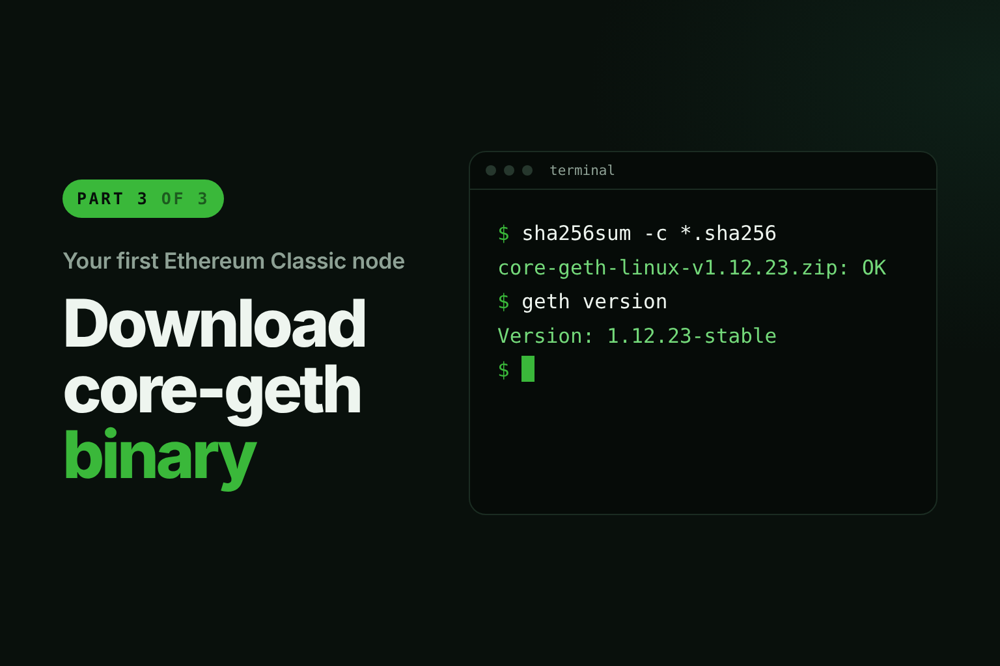
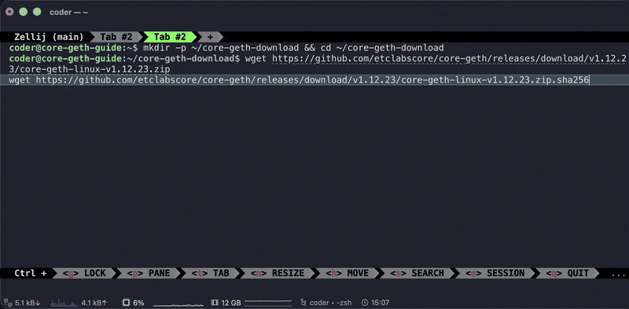
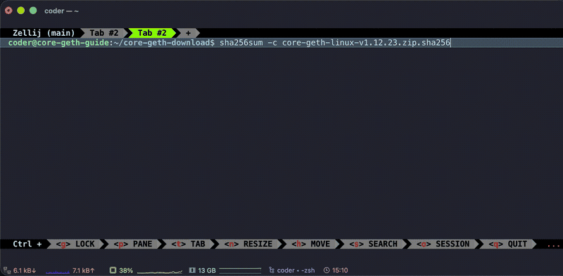
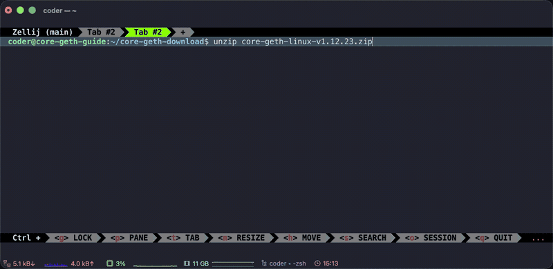
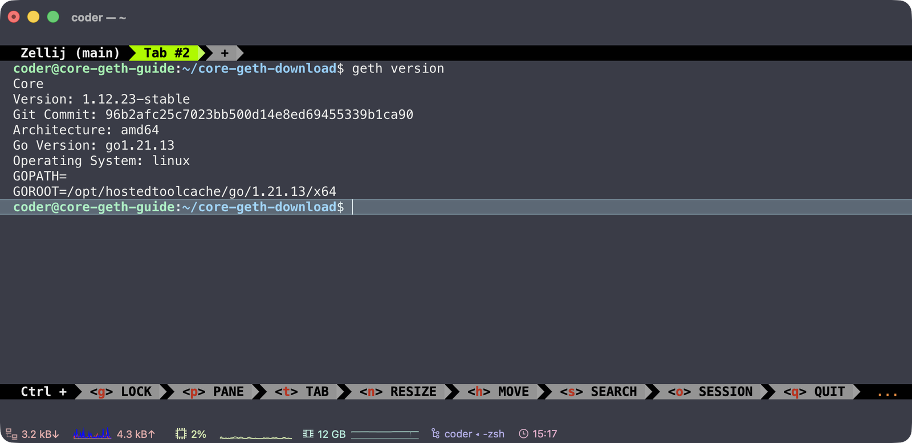
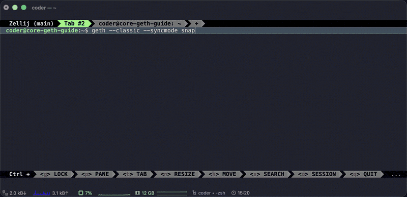
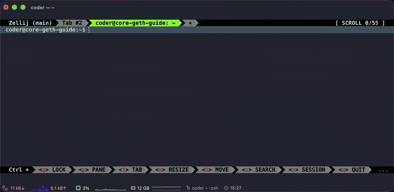

In [Part 1](/blog/2026-10-15-run-your-own-etc-node-part-1-build-core-geth-from-source), I showed you how to build core-geth from the source we got from the actively maintained GitHub repository. It's by far the most challenging route, but it's also the most secure, because you build the entire thing yourself, from source, every step of the way. In [Part 2](/blog/2026-10-28-run-your-own-etc-node-part-2-run-core-geth-with-docker), we ran it with Docker. It's a little less challenging to set up, but once you have it, starting core-geth is a one-liner. For this last part, we're going to do the simplest thing of all: download the finished program from the core-geth repository and run it. You don't get to build every piece yourself, and you have to trust the binary in some way, but it's the easiest way to get up and running.

Every core-geth release on GitHub comes with ready-made downloads, called binaries. A binary is a program that's already built and ready to run on your specific operating system. So there's no Go to install, no building, and no Docker, or really any other prerequisites. You download one zip file, check that it's the real thing, unzip it, and start your node. We'll use v1.12.23 "Argos", the latest stable release of core-geth as of writing.

Here's how the three approaches in this series compare:

| | Part 1: Build from source | Part 2: Docker | Part 3: Download the binary |
| --- | --- | --- | --- |
| **What you do** | Download the code and build it yourself | Run a ready-made image in a container | Download a ready-made program and run it |
| **What you install first** | Git, build tools and Go | Docker | Nothing |
| **Time to get going** | Longest | Medium, plus Docker's install | Shortest |
| **Best for** | Trying the development version, or reading and changing the code | Keeping the node separate from the rest of your machine | The fastest way to run a stable release |

This is part 3 of a three-part series. If you get stuck at any point, ask in [r/EthereumClassic](https://www.reddit.com/r/EthereumClassic/). The community is always happy to help.

**Not covered here:** waiting for a full sync, mining, or opening your node up to the internet. See [Next steps](#next-steps). This guide uses the Linux download. If you're on macOS, Windows or an ARM device, the [releases page](https://github.com/etclabscore/core-geth/releases) has downloads for those too, but the steps below are written and tested for Linux.

## Before you start

You need:

- A Linux machine running Ubuntu or Debian on a standard 64-bit Intel or AMD processor. This guide was recorded on a cloud Linux machine over SSH, but a virtual machine (VM) or a spare computer at home works the same way.
- An account that can run `sudo` (admin) commands.
- A terminal, and about 15 minutes. The download is only about 32 MB.

**Check your processor type.** The download in this guide is for 64-bit Intel and AMD processors. To check yours:

```bash
uname -m
```

**What you'll see:** `x86_64`. That's the one this guide covers. If you see `aarch64` or something starting with `arm`, your machine needs one of the ARM downloads on the [releases page](https://github.com/etclabscore/core-geth/releases) instead.

**Install the two small tools you need** to download and unzip the file:

```bash
sudo apt update && sudo apt install -y wget unzip
```

**What it means:** `wget` downloads files and `unzip` opens zip files. If your machine already has them, apt says so and carries on.

**If you followed Part 1 or Part 2 and your node is still running, stop it first** ([Part 1, step 8](/blog/2026-10-15-run-your-own-etc-node-part-1-build-core-geth-from-source#step-8-stop-the-node-safely) or [Part 2, step 6](/blog/2026-10-28-run-your-own-etc-node-part-2-run-core-geth-with-docker#step-6-stop-start-and-remove)). All three use the same port, and a second node won't start while another is running.

### Hardware

Recommended hardware for running core-geth with a snap sync on ETC mainnet, as of November 2026:

| | Recommended | Notes |
| --- | --- | --- |
| **CPU** | 4+ cores | A synced node uses less than one core |
| **RAM** | 16 GB+ | The client itself uses about 4 GB once synced. The extra covers the memory spike during the initial sync. Less can work with swap, but the sync is slower |
| **Disk** | 500 GB SSD or NVMe | A synced node uses about 85–100 GB today (chain data plus ethash caches). The rest leaves room for the chain to grow. Avoid spinning hard drives |
| **Internet** | 25+ Mbit/s download | Slower connections work, but the initial sync takes longer |

ETC's chain is much smaller than Ethereum's, so these numbers are well below [go-ethereum's hardware requirements](https://github.com/ethereum/go-ethereum#hardware-requirements) for Ethereum mainnet, which call for 2 TB or more of disk.

## Step 1: Download core-geth

Make a folder for the download and go into it:

```bash
mkdir -p ~/core-geth-download && cd ~/core-geth-download
```

**What you'll see:** nothing. Your prompt now shows the new folder name.

Then download the zip file and its checksum file. The checksum file is a tiny text file we'll use in the next step to check the download:

```bash
wget https://github.com/etclabscore/core-geth/releases/download/v1.12.23/core-geth-linux-v1.12.23.zip
wget https://github.com/etclabscore/core-geth/releases/download/v1.12.23/core-geth-linux-v1.12.23.zip.sha256
```

**What you'll see:** a progress bar for each download, ending with a line saying the file was saved.

**What it means:** both files are now in your folder. Check:

```bash
ls -lh
```

**What you'll see:** the two files, with the zip at about 32M.

- `core-geth-linux-v1.12.23.zip` is the program itself. `v1.12.23` is the release, and `linux` is the version for Linux.
- The release page also has an `alltools` zip. It adds extra developer tools and is much bigger (about 210 MB). You don't need it for this guide.



## Step 2: Verify the download

Before you run anything you downloaded, check that the file arrived complete and unchanged:

```bash
sha256sum -c core-geth-linux-v1.12.23.zip.sha256
```

**What you'll see:**

```text
core-geth-linux-v1.12.23.zip: OK
```

**What it means:** `sha256sum` worked out the zip file's checksum, a long fingerprint made from its contents, and compared it to the one in the checksum file. `OK` means they match, so the download is complete and wasn't damaged on the way.

To see the fingerprint it compared against:

```bash
cat core-geth-linux-v1.12.23.zip.sha256
```

**What you'll see:**

```text
a2cc3edb3b92c6def7e89d732c136b8a759ff01126dbb6f60cb9e1132264e4a0  core-geth-linux-v1.12.23.zip
```

If you see `FAILED` instead of `OK`, don't use the file. Delete it with `rm core-geth-linux-v1.12.23.zip`, download it again, and re-run the check.



## Step 3: Unzip it and check the version

```bash
unzip core-geth-linux-v1.12.23.zip
```

**What you'll see:**

```text
Archive:  core-geth-linux-v1.12.23.zip
  inflating: geth
```

**What it means:** the zip held one file, called `geth`. That's core-geth itself, ready to run. Check it works:

```bash
./geth version
```

**What you'll see:**

```text
Core
Version: 1.12.23-stable
Git Commit: 96b2afc25c7023bb500d14e8ed69455339b1ca90
Architecture: amd64
Go Version: go1.21.13
Operating System: linux
GOPATH=
GOROOT=/opt/hostedtoolcache/go/1.21.13/x64
```

**What it means:** `Version: 1.12.23-stable` is the release you wanted. The `./` in front of `geth` means "the geth in this folder". The Go version and `GOROOT` show how the program was built, on the project's build machine. You don't need Go installed.



## Step 4: Move geth so you can run it from anywhere

Right now `geth` only runs from this folder. Move it to a folder that Linux checks for programs, so you can type `geth` from anywhere:

```bash
sudo mv geth /usr/local/bin/
```

**What you'll see:** nothing, unless it asks for your password.

**What it means:** `geth` now lives in `/usr/local/bin`, where Linux looks for programs. If you already put a `geth` there in Part 1, this replaces it with this download. Check it:

```bash
which geth
```

**What you'll see:**

```text
/usr/local/bin/geth
```

Then:

```bash
geth version
```

**What you'll see:** the same version details as in step 3, starting with `Version: 1.12.23-stable`.

The zip and checksum files in `~/core-geth-download` have done their job. You can keep them or delete the folder.



## Step 5: Start your node

In this terminal (call it terminal A), run:

```bash
geth --classic --syncmode snap
```

**What you'll see:** lines of text start scrolling, beginning with:

```text
INFO [11-18|23:20:09.848] Starting Geth on Ethereum Classic...
```

**What it means:** your node has started and is joining Ethereum Classic. It will look for other nodes, then begin to sync. The scrolling never stops while the node runs, and your prompt won't come back. Leave this terminal alone. A few `WARN` lines in the first minutes are normal, and during a snap sync you'll also see some `ERROR` lines such as `Expired request does not exist` or `Pending request exists for joining peer`. These are harmless as long as the node keeps syncing.

- `--classic` joins Ethereum Classic. Without it, geth joins Ethereum instead.
- `--syncmode snap` is the fastest way to catch up. [Part 1](/blog/2026-10-15-run-your-own-etc-node-part-1-build-core-geth-from-source#step-6-start-your-node) explains the other sync modes.

**Want to keep your chain data somewhere else?** By default, geth saves it in `~/.ethereum/classic`. To use a different folder, add `--datadir /your/folder` to the command above. If you do, you'll need to add the same `--datadir` every time you start the node and every time you attach to it, or geth will start syncing from scratch in the default folder.



## Step 6: Talk to your node

Open a second terminal (terminal B) on the same machine. Wait about a minute after starting the node, then run:

```bash
geth --classic attach
```

**What you'll see:**

```text
Welcome to the Geth JavaScript console!

instance: CoreGeth/v1.12.23-stable-96b2afc2/linux-amd64/go1.21.13
at block: 0 (Thu Jan 01 1970 00:00:00 GMT+0000 (UTC))
 datadir: /home/yourname/.ethereum/classic
 modules: admin:1.0 debug:1.0 engine:1.0 eth:1.0 ethash:1.0 miner:1.0 net:1.0 rpc:1.0 trace:1.0 txpool:1.0 web3:1.0

To exit, press ctrl-d or type exit
>
```

**What it means:** you're in your node's console. **From here, commands go to your node, not to Linux,** until you type `exit`. The `instance` line shows the version that's running: `v1.12.23-stable`. Your `datadir` line shows your own username.

Type each of these after the `>` and press Enter:

| Command | What you'll see | What it means |
| --- | --- | --- |
| `eth.chainId()` | `"0x3d"` | 61 in hexadecimal: ETC's chain ID. You're on Ethereum Classic |
| `net.peerCount` | A number, such as `7` | How many other nodes you're connected to. Anything above 0 means you're part of the network |
| `eth.syncing` | A block of details, including `currentBlock` and `highestBlock` | How far your node has synced. Shows `false` once it has caught up |
| `eth.blockNumber` | A number, often `0` during a snap sync | Normal at this stage. It jumps up near the end of the sync |

Type `exit` or press **Ctrl+D** to leave the console. Your node keeps running in terminal A. [Part 1, step 7](/blog/2026-10-15-run-your-own-etc-node-part-1-build-core-geth-from-source#step-7-talk-to-your-node-with-the-console) has more console commands and tips, and they all work here too.

**Keep your IP address private:** `admin.nodeInfo` and `admin.peers` show IP addresses, so keep their output out of posts and screenshots.



## Step 7: Stop and start again

To stop your node:

1. In terminal B, type `exit` to leave the console, if you're still in it.
2. In terminal A, press **Ctrl+C** once, then wait about a minute. The node saves its work and shuts down cleanly, then your prompt comes back.

**Press Ctrl+C only once, and don't close the window while it shuts down.** Interrupting a shutdown can damage the data your node has downloaded.

To start it again, run the step 5 command again. If you used `--datadir`, use the same one. Your node carries on from where it left off.

Congratulations! You're running your own Ethereum Classic node from the core-geth binary, and you've now run one three different ways. Once it's fully synced, you can query the blockchain directly, build your own block explorer, monitor the network, or create and deploy smart contracts and dApps, all without relying on a trusted third party or service.

## Troubleshooting

Find the message you're seeing, then follow the fix. Still stuck? Ask in [r/EthereumClassic](https://www.reddit.com/r/EthereumClassic/), and include the command you ran and the message you saw.

**`wget: command not found` or `unzip: command not found`.** Install them with `sudo apt update && sudo apt install -y wget unzip`, then try again.

**`FAILED` from `sha256sum -c`.** The download is damaged or incomplete. Delete the zip with `rm core-geth-linux-v1.12.23.zip`, download it again, and re-run the check. Don't run a file that fails.

**`No such file or directory`.** You're not in the folder that holds the file. Run `cd ~/core-geth-download` and try again.

**`cannot execute binary file: Exec format error`.** You downloaded the wrong version for your processor. Run `uname -m`. If it says `aarch64` or starts with `arm`, use one of the ARM downloads from the [releases page](https://github.com/etclabscore/core-geth/releases) instead.

**`geth: command not found`.** Step 4 hasn't been done, or didn't work. Run `ls /usr/local/bin/geth` to check. If it isn't there, go back to the folder with the file and repeat `sudo mv geth /usr/local/bin/`. Or run it from that folder as `./geth`.

**`Permission denied` when you run `./geth`.** Make the file runnable with `chmod +x geth`, then try again.

**`Unable to attach to remote geth`.** Check that the node is still running in terminal A, that you waited a minute after starting it, that you used the same `--classic` and `--datadir` as the node, and that you didn't use `sudo`.

**`eth.chainId()` shows `"0x1"`.** You're on Ethereum, not Ethereum Classic. Stop the node and start it again with `--classic`.

**`datadir already used by another process` or `address already in use` when starting the node.** Another node is already running: one started with `geth` (`datadir already used by another process`), or the Docker container from Part 2 (`address already in use`, because it holds port 30303). Stop it, then try again.

## Next steps

- **Finish a full sync:** leave the node running until `eth.syncing` shows `false`. Check you have the disk space listed under Hardware first.
- **Run it in the background:** right now your node runs in the terminal window, so closing it stops the node. To keep it running, set it up as a systemd service, or use the Docker route from [Part 2](/blog/2026-10-28-run-your-own-etc-node-part-2-run-core-geth-with-docker).
- **Update to a newer version:** when a new release comes out, stop your node (step 7), then repeat steps 1 to 4 with the new version number in the file names and links. Your chain data carries over.
- **Try the other downloads:** the [releases page](https://github.com/etclabscore/core-geth/releases) has builds for macOS, Windows and ARM devices, each with its own checksum file.
- **Free up the space:** stop your node, then run `geth --classic removedb`. Add the same `--datadir` if you used one.
